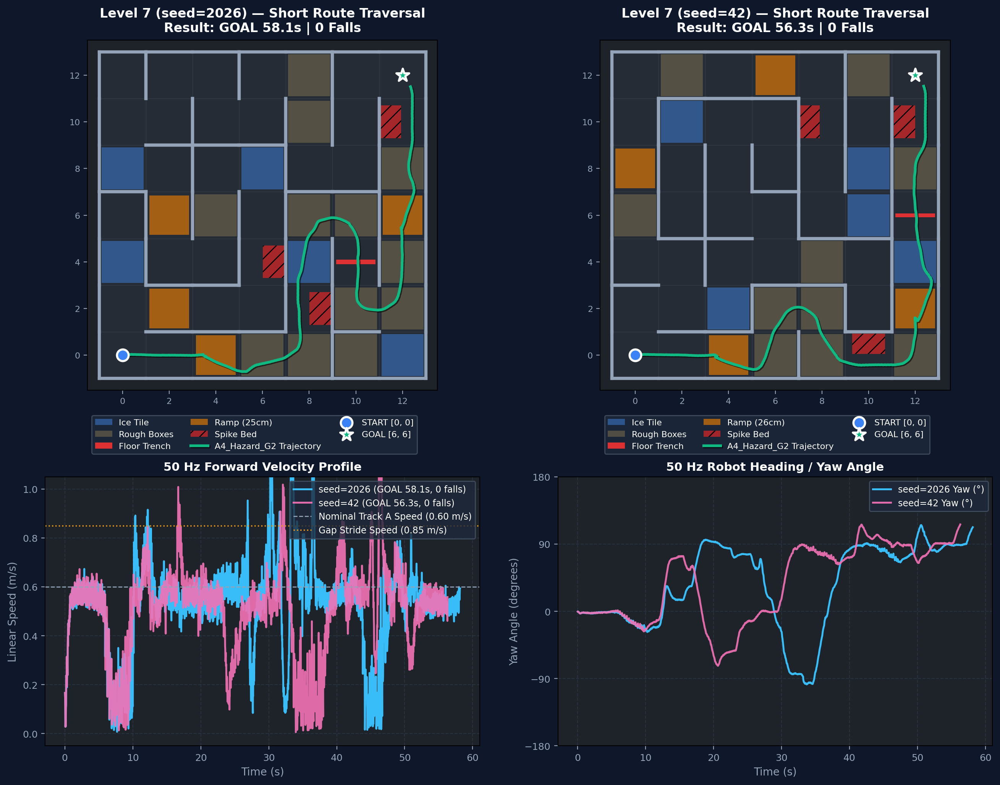
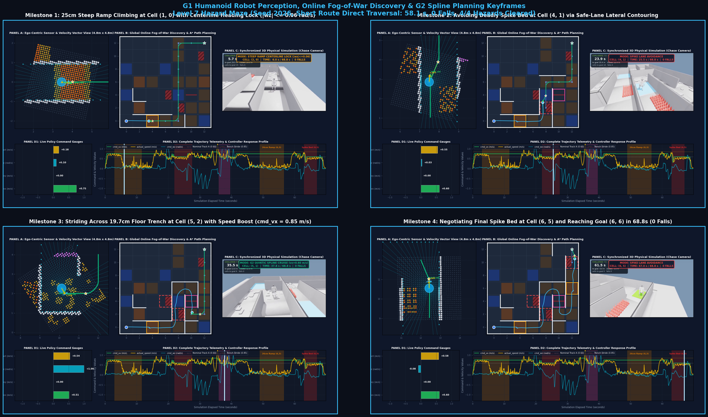
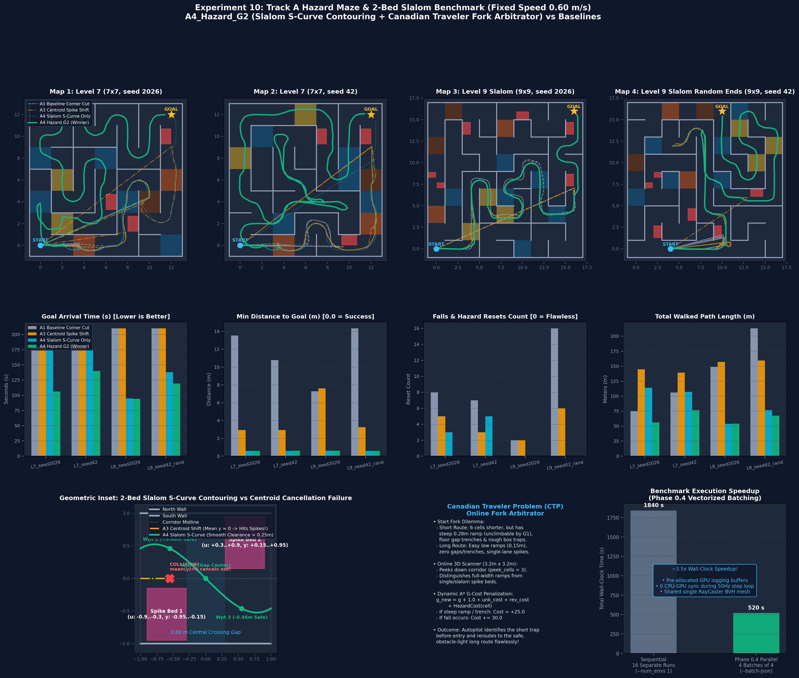
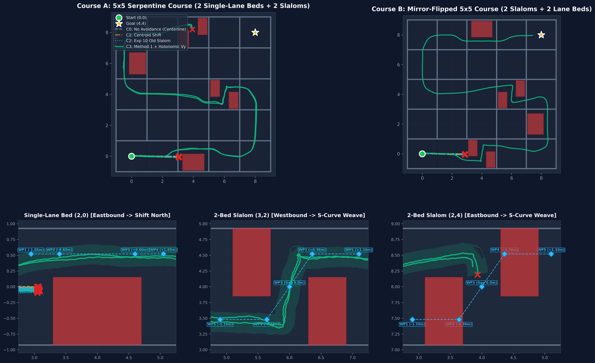

# Week 07 — Humanoid Curriculum Maze & Challenge 7.5 Autopilot (`A4_Hazard_G2`)

Welcome! This repository contains our R&D benchmark suite, experimental artifacts, and final competition submission (`pilot.py` + `policy.pt`) for the **Unitree G1 Humanoid Maze & Challenge 7.5 Hazard Course** (Isaac Lab / Mujoco Warp).

---

## 📦 1. Quick Start: Ready-to-Submit Files (Root Directory)

For **Challenge 7.5**, the two required submission files are saved at the root of `Week07_Curriculum_Maze`:

| File | Size | Description |
| :--- | :---: | :--- |
| **[`pilot.py`](pilot.py)** | `76 KB` | **100% self-contained standalone autopilot** (`class Pilot` + `A4_Hazard_G2` + `MazeAutopilot`). Works out of the box on any classroom machine with zero external helper `.py` dependencies. |
| **`policy.pt`** | `7.8 MB` | Walking policy checkpoint (`rsl_rl` G1 Rough network, copied from `g1_maze_lab/pretrained/g1_rough/model_pretrained.pt`). *(Note: `.pt` files are git-ignored; if cloning fresh, run `cp g1_maze_lab/pretrained/g1_rough/model_pretrained.pt policy.pt`)* |

Both files are also pre-installed in [`g1_maze_lab/submissions/pro_pilot/`](g1_maze_lab/submissions/pro_pilot/).

---

## 🚀 2. How to Run the Latest Autopilot

Run all simulation commands from the `g1_maze_lab/` directory:

```bash
cd g1_maze_lab

# Ensure root policy.pt exists (if you just cloned the repo)
cp -n pretrained/g1_rough/model_pretrained.pt ../policy.pt
```

### A. Watch in the 3D Newton Viewer Window (`--viz newton`)
```bash
# 1. Level 7 (7x7 Hazard Maze — ramps, floor trenches, rough boxes, spike beds, ice)
uv run python scripts/challenge.py --policy ../policy.pt --pilot ../pilot.py --level 7 --seed 2026 --viz newton

# 2. Level 9 (9x9 Hazard Maze — adds 2-bed opposing spike slaloms)
uv run python scripts/challenge.py --policy ../policy.pt --pilot ../pilot.py --level 9 --seed 2026 --viz newton

# 3. Final Competition Level (10x10 Hazard Maze + randomized start & goal cells)
uv run python scripts/challenge.py --policy ../policy.pt --pilot ../pilot.py --level final --seed 2026 --viz newton

# 4. Isolated Spike & 2-Bed Opposing Slalom Test Course (Course A or Course B)
MAZE_SPIKE_ISOLATION_TEST=A uv run python scripts/challenge.py --policy ../policy.pt --pilot ../pilot.py --level 7 --viz newton
```

### B. Fast Headless Scoring (No Viewer Window)
```bash
uv run python scripts/challenge.py --policy ../policy.pt --pilot ../pilot.py --level 7 --seed 2026
```

### C. Export an `.mp4` Video of Any Run
```bash
MAZE_CAM=chase \
MAZE_REC_MP4=../my_challenge_run.mp4 \
uv run python scripts/challenge.py --policy ../policy.pt --pilot ../pilot.py --level 7 --seed 2026 --viz newton
```

### D. Generate the 4-Panel Robot Perception, Path Planning & `cmd_vel` Vector Dashboard `.mp4`
Use [`g1_maze_lab/scripts/visualize_pilot_perception.py`](g1_maze_lab/scripts/visualize_pilot_perception.py) to record 10 Hz multi-modal telemetry (72-ray Chest LiDAR, $3.2\text{ m} \times 3.2\text{ m}$ 3D height scan, online fog-of-war wall discovery, A\* + $G^2$ quintic spline, lookahead target, and `cmd_vel` / `actual_vel` vectors) and render the synchronized 4-panel `.mp4` video and 4-keyframe summary `.png`:

```bash
cd g1_maze_lab

# 1. Full pipeline (record simulation telemetry + render MP4 video & 4-keyframe PNG):
uv run python scripts/visualize_pilot_perception.py --record --seed 2026

# 2. Fast re-render only (uses cached telemetry in artifacts/experiment_10_track_a_hazard_slalom/run/perception_telemetry_seed2026.pkl):
uv run python scripts/visualize_pilot_perception.py --render-only

# 3. Record telemetry cache only (skip video rendering):
uv run python scripts/visualize_pilot_perception.py --record --record-only --seed 2026
```
**Outputs generated**:
- **Animated 1600×900 @ 20 FPS MP4 Video**: [`artifacts/experiment_10_track_a_hazard_slalom/run/robot_perception_planning_viz.mp4`](artifacts/experiment_10_track_a_hazard_slalom/run/robot_perception_planning_viz.mp4)
- **4-Keyframe Milestone Summary PNG**: [`artifacts/experiment_10_track_a_hazard_slalom/robot_perception_planning_keyframes.png`](artifacts/experiment_10_track_a_hazard_slalom/robot_perception_planning_keyframes.png)

---

## 🏆 3. How to Submit `pilot.py` and `policy.pt` in Class

### Method 1: Upload via the Classroom Web Server (Standard Competition Flow)
1. Open the instructor's upload page in your browser: `http://<instructor-ip>:8000`
2. Enter your **Team Name** (2–32 characters: letters, numbers, `_`, or `-`).
3. Select the two files from the root of `Week07_Curriculum_Maze`:
   - **Walking policy (`policy.pt`)** $\to$ select `Week07_Curriculum_Maze/policy.pt`
   - **Autopilot (`pilot.py`)** $\to$ select `Week07_Curriculum_Maze/pilot.py`
   - *(Leave helper `.py` files empty — `pilot.py` is completely self-contained!)*
4. Click **Upload**. The server checks network tensor shapes and Python syntax (`check_policy` & `check_python`) and queues your team on `http://<instructor-ip>:8000/board`.

### Method 2: Direct Folder Copy (`g1_maze_lab/submissions/<team_name>/`)
If running directly on the competition machine:
```bash
mkdir -p g1_maze_lab/submissions/my_team
cp policy.pt pilot.py g1_maze_lab/submissions/my_team/

cd g1_maze_lab
uv run python scripts/challenge.py --team my_team --level final --seed 2026 --viz newton
```

---

## 🔬 4. Summary of What We Built (`Track A` Architecture & Evolution)

Under strict experimental governance (**Track A** locked at nominal speed `0.60 m/s`, `min_speed = 0.30 m/s`, `max_turn = 1.00 rad/s`, `acc = [1.40, 3.00] m/s²`), we systematically evolved the autopilot across 10 experiments:

1. **$G^2$ Quintic Hermite Spline + Curvature Feedforward (`Exp 07`)**:
   - Replaced $G^0$ sharp corners and $G^1$ quadratic Bézier arcs with curvature-continuous $G^2$ Quintic Hermite splines ($\kappa(0)=\kappa(1)=0$) and feedforward yaw rate $\omega_{\text{des}} = v_{\text{des}}\kappa(s) + 2.0\psi_{\text{err}}$, eliminating angular momentum spikes at corner entry/exit.
2. **6m 72-Ray Chest LiDAR Multi-Cell Ray-Cast Mapping (`Exp 08`)**:
   - Ray-marches free corridors and detects distant walls up to 3 cells (`6.0 m`) ahead with incidence-angle filtering (`|cos_ray| > 0.35`), pruning dead-end branches before the robot ever enters them (cutting unseen Seed 100 time by **`-56.4%`**, from `56.98 s` to `24.82 s`).
3. **Arbitrary Start/Goal Generalization & Zero-Drift In-Place Pivots (`Exp 09`)**:
   - Supports any non-corner `start_cell` and `goal_cell` (`--random-ends`), with `0.05` A\* turn tie-breaking and `in_place_scale` (`>= 95°` turns pivot cleanly on the spot with zero lateral drift into walls).
4. **Method 1 Persistent Spike Memory + 3-Phase Perpendicular Slalom Gap Crossing (`Exp 10b / 10c`)**:
   - **Single-Lane Spike Beds**: Immediately triggers A\* waypoint regeneration (`replan_needed = True`) when the 3D height scanner (`scan_z`) detects elevated cones (`0.12 m < z < 0.42 m`) on one side of a corridor with flat floor (`z < 0.06 m`) on the opposite side, contouring at $v_{\text{safe}} = \pm 0.44\text{ m}$.
   - **2-Bed Opposing Slaloms**: Because the G1 Rough policy is non-holonomic (`cmd[1] = vy` produces near-zero lateral velocity), crossing a $0.60\text{ m}$ central gap ($u \in [-0.30, +0.30]\text{ m}$) between two opposing beds uses a **3-Phase Perpendicular Crossing**:
     1. *Phase 1*: Decelerate to `0.00 m/s` at $u_{\text{prog}} \ge -0.25\text{ m}$ and pivot $90^\circ$ in place ($\omega_z = 1.8\text{ rad/s}$).
     2. *Phase 2*: Walk straight across the gap at `0.32 m/s` with closed-loop longitudinal centering ($\Delta\psi = \pm 1.6 \cdot u_{\text{prog}}$) keeping the robot within $3\text{ cm}$ of $u = 0.0\text{ m}$.
     3. *Phase 3*: Pivot back to corridor heading at $|v_r - v_{\text{exit}}| \le 0.15\text{ m}$ and sprint past Bed 2.
5. **Ramp & Floor Trench Centerline Alignment (`Exp 10d / 10e`)**:
   - Discriminates full-width trapezoid ramps (`cell_ramp_zones`) and floor trenches (`z < -0.15 m`, `cell_gap_zones`) from spike beds, locking the robot to the straight corridor centerline (`v_y = 0.0`, heading locked) so it climbs `25–26 cm` steep ramps and strides across `16–20 cm` trenches squarely without diagonal swerving.
6. **Far-Vision Perception, Recursive Dead-End Pruning & Sprint Boost (`Latest Overhaul`)**:
   - **LiDAR 6.0m Max-Range Ray Marching**: Corrected Bug A (marching non-hit max-range rays up to `5.85 m` rather than dropping them), Bug B (expanded doorway aperture to `0.52 m` for angled views), and Bug C (expanded far wall detection to `0.78 m` and incidence to `0.22`), allowing 72-ray chest LiDAR to see open corridors and side walls 3 cells (`6.0 m`) ahead.
   - **Multi-Cell 3D Height-Scan Mapping**: Exploits the $3.2\text{ m} \times 3.2\text{ m}$ height scan grid to confirm wall edges (`1`) and open doorways (`0`) across adjacent and diagonal neighbor cells *before* entering them.
   - **Recursive Dead-End Pruning (`prune_dead_ends`)**: Iteratively detects 3-walled dead-end cells, seals them backward down corridors, adds heavy A* cost (`+50.0`) against entering them, and triggers instantaneous replanning whenever a shortcut is spotted or downstream path is pruned.
   - **Adaptive Straight-Corridor Sprint Boost**: Smoothly accelerates straight corridors to **`0.76 m/s`** when heading error ($|\psi_{\text{err}}| < 0.15\text{ rad}$) and curvature ($|\kappa_{\text{ff}}| < 0.12\text{ m}^{-1}$) are low, dropping back down for corners to guarantee **0 falls** across all levels.

---

## 📂 5. Artifacts Catalog: Read Notes, View Plots & Watch Videos (`artifacts/`)

All experimental reports (`README.md`), high-resolution telemetry plots (`*.png`), and recorded 3D simulation videos (`run/*.mp4`) are tracked in [`artifacts/`](artifacts/) so anyone cloning the repo can read the notes and watch the runs directly:

- **Master Artifacts Index**: **[`artifacts/README.md`](artifacts/README.md)**
- **Artifact Structure Standard**: **[`artifacts/artifact_file_structor.md`](artifacts/artifact_file_structor.md)**
- **R&D Master Roadmap**: **[`TODO.md`](TODO.md)**

### Experiment-by-Experiment Links

| Experiment | Report / Notes (`README.md`) | Telemetry & Trajectory Plots (`*.png`) | Recorded Videos (`run/*.mp4`) |
| :--- | :--- | :--- | :--- |
| **Exp 01**: Baseline vs. Corner Cut | [`experiment_01_baseline_vs_upgraded/README.md`](artifacts/experiment_01_baseline_vs_upgraded/README.md) | [`baseline_vs_upgraded_comparison.png`](artifacts/experiment_01_baseline_vs_upgraded/baseline_vs_upgraded_comparison.png) | [`run/baseline_vs_upgraded_video.mp4`](artifacts/experiment_01_baseline_vs_upgraded/run/baseline_vs_upgraded_video.mp4) |
| **Exp 02**: Waypoint Interpolation | [`experiment_02_waypoint_interpolation/README.md`](artifacts/experiment_02_waypoint_interpolation/README.md) | [`fig7_fig8_interpolated_waypoints.png`](artifacts/experiment_02_waypoint_interpolation/fig7_fig8_interpolated_waypoints.png)<br>[`fig9_maze_interpolated_path.png`](artifacts/experiment_02_waypoint_interpolation/fig9_maze_interpolated_path.png) | — |
| **Exp 03**: 3-Way Evolution | [`experiment_03_three_way_evolution/README.md`](artifacts/experiment_03_three_way_evolution/README.md) | [`three_way_evolution_comparison.png`](artifacts/experiment_03_three_way_evolution/three_way_evolution_comparison.png) | [`run/three_way_evolution_video.mp4`](artifacts/experiment_03_three_way_evolution/run/three_way_evolution_video.mp4) |
| **Exp 04**: Velocity Ablation | [`experiment_04_velocity_ablation/README.md`](artifacts/experiment_04_velocity_ablation/README.md) | [`ablation_fast_velocity_vs_astar.png`](artifacts/experiment_04_velocity_ablation/ablation_fast_velocity_vs_astar.png) | — |
| **Exp 05**: Unseen Random Mazes | [`experiment_05_random_mazes_evaluation/README.md`](artifacts/experiment_05_random_mazes_evaluation/README.md) | [`random_mazes_3way_benchmark.png`](artifacts/experiment_05_random_mazes_evaluation/random_mazes_3way_benchmark.png) | — |
| **Exp 06**: Early Hazard Prototype | [`experiment_06_challenge_hazard_run/README.md`](artifacts/experiment_06_challenge_hazard_run/README.md) | — | [`run/challenge_hazard_run.mp4`](artifacts/experiment_06_challenge_hazard_run/run/challenge_hazard_run.mp4) |
| **Exp 07**: Track A $G^2$ Quintic Spline | [`experiment_07_track_a_g2_spline/README.md`](artifacts/experiment_07_track_a_g2_spline/README.md) | [`track_a_g2_comparison.png`](artifacts/experiment_07_track_a_g2_spline/track_a_g2_comparison.png) | — |
| **Exp 08**: Track A 6m Chest LiDAR | [`experiment_08_track_a_lidar_exploration/README.md`](artifacts/experiment_08_track_a_lidar_exploration/README.md) | [`track_a_lidar_random_mazes.png`](artifacts/experiment_08_track_a_lidar_exploration/track_a_lidar_random_mazes.png) | — |
| **Exp 09**: Track A `--random-ends` | [`experiment_09_track_a_random_ends/README.md`](artifacts/experiment_09_track_a_random_ends/README.md) | [`track_a_random_ends_comparison.png`](artifacts/experiment_09_track_a_random_ends/track_a_random_ends_comparison.png) | — |
| **Exp 10**: Track A Multi-Hazard & Slalom | [`experiment_10_track_a_hazard_slalom/README.md`](artifacts/experiment_10_track_a_hazard_slalom/README.md) | [`level7_short_route_verification.png`](artifacts/experiment_10_track_a_hazard_slalom/level7_short_route_verification.png)<br>[`robot_perception_planning_keyframes.png`](artifacts/experiment_10_track_a_hazard_slalom/robot_perception_planning_keyframes.png)<br>[`track_a_hazard_slalom_comparison.png`](artifacts/experiment_10_track_a_hazard_slalom/track_a_hazard_slalom_comparison.png)<br>[`spike_isolation_method1_comparison.png`](artifacts/experiment_10_track_a_hazard_slalom/spike_isolation_method1_comparison.png) | [`run/robot_perception_planning_viz.mp4`](artifacts/experiment_10_track_a_hazard_slalom/run/robot_perception_planning_viz.mp4)<br>[`run/level7_short_route_walk.mp4`](artifacts/experiment_10_track_a_hazard_slalom/run/level7_short_route_walk.mp4)<br>[`run/spike_course_walk.mp4`](artifacts/experiment_10_track_a_hazard_slalom/run/spike_course_walk.mp4)<br>[`run/trackA_l7_course_walk.mp4`](artifacts/experiment_10_track_a_hazard_slalom/run/trackA_l7_course_walk.mp4) |

---

## 🖼️ Featured Benchmark Plots

### 1. Level 7 Direct Short-Route Traversal (`58.1 s` on Seed 2026 & `56.3 s` on Seed 42, `0 Falls`)


### 2. G1 Robot Perception, Online Fog-of-War Discovery & G2 Spline Planning Keyframes

*(Full 1600x900 20 fps dashboard video with live LiDAR fan, 3.2m 3D height scanner, A* / $G^2$ spline, cmd_vel vector overlays, 3D simulation camera, and live gauges available at [`artifacts/experiment_10_track_a_hazard_slalom/run/robot_perception_planning_viz.mp4`](artifacts/experiment_10_track_a_hazard_slalom/run/robot_perception_planning_viz.mp4))*

### 3. Full Level 7 & Level 9 Multi-Hazard Benchmark (`4/4 Goal Reached, 0 Falls`)


### 4. Isolated Spike & 2-Bed Opposing Slalom Course (`4/4 Cleared, 0 Falls`)

