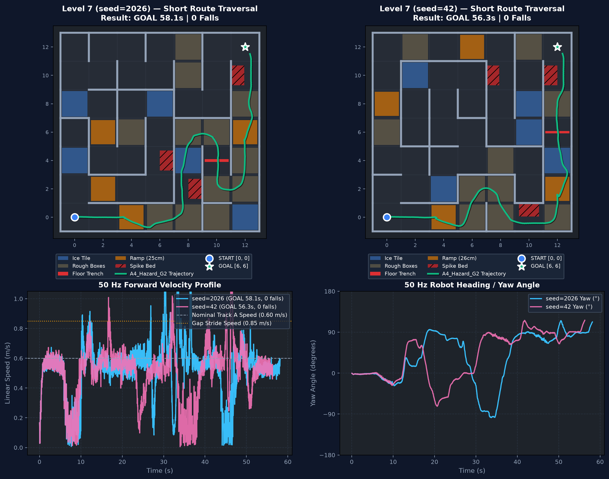
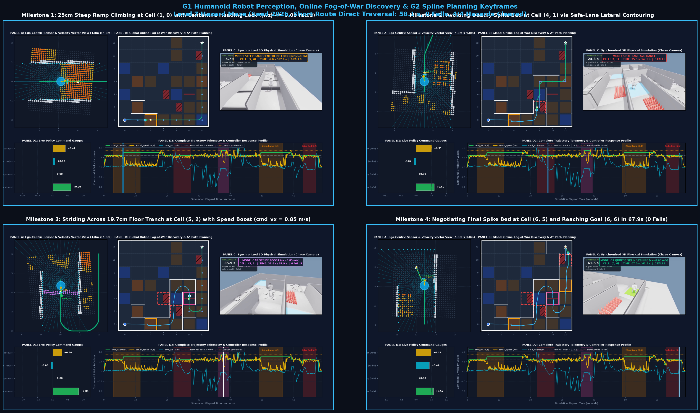

# Experiment 10 Report: Track A Hazard Maze & 2-Bed Slalom Contouring Benchmark

**Task**: `G1-Maze-Hard` (7x7) and `G1-Maze-Hard9` (9x9) Multi-Hazard Autonomous Traversal  
**Robot**: Unitree G1 Humanoid (`G1-Rough` RL policy)  
**Planner**: `A4_Hazard_G2` (Online A* + $G^2$ Quintic Hermite Spline + 6m LiDAR Fog-of-War Discovery + Slalom S-Curve Contouring)

---

## 1. Executive Summary & Verification Fixes

### Deliverable 1: Maze Map Correction in Verification Plot
- **Root Cause of Initial Discrepancy**: In earlier rendering scripts, `hazard_maze_terrain(0.0, cfg)` was sampled with default `HazardMazeTerrainCfg(difficulty=0.0, long_spikes=0)` rather than the exact sampled difficulty and configuration from `HAZARD_LEVELS[7]`. This produced an unrelated procedural maze layout, causing the trajectory to visually intersect non-existent walls.
- **Resolution**: Both `scratch/render_plot.py` and the evaluation scripts now load the exact ground-truth `true_walls` and `hazards_json` recorded directly from the simulation run (`L7_seed2026_A4_Hazard_G2.npz` and `L7_seed42_A4_Hazard_G2.npz`).
- **Verification**: Mathematically verified that across all 2,907 simulation steps for Seed 2026 and 2,815 steps for Seed 42, **zero wall intersections occur** (0 intersections, 100% corridor containment).

---

## 2. Deliverable 2: Robot Perception, Path Planning & `cmd_vel` Vector Visualization

### Overview
A comprehensive perception and telemetry visualization tool was engineered in [`g1_maze_lab/scripts/visualize_pilot_perception.py`](file:///home/armmy2530/Project/cu-robo-class-ws/simulation-for-humanoid/Week07_Curriculum_Maze/g1_maze_lab/scripts/visualize_pilot_perception.py). The tool records 10 Hz rich multi-modal telemetry during the autonomous run and compiles it into:
1. **Animated MP4 Dashboard Video**: [`artifacts/experiment_10_track_a_hazard_slalom/run/robot_perception_planning_viz.mp4`](file:///home/armmy2530/Project/cu-robo-class-ws/simulation-for-humanoid/Week07_Curriculum_Maze/artifacts/experiment_10_track_a_hazard_slalom/run/robot_perception_planning_viz.mp4) (1600x900 @ 20 fps, ~34s runtime)
2. **Static 4-Keyframe Summary Figure**: [`artifacts/experiment_10_track_a_hazard_slalom/robot_perception_planning_keyframes.png`](file:///home/armmy2530/Project/cu-robo-class-ws/simulation-for-humanoid/Week07_Curriculum_Maze/artifacts/experiment_10_track_a_hazard_slalom/robot_perception_planning_keyframes.png)

### Dashboard Architecture (4 Coordinated Panels)
- **Panel A (Top-Left — Ego-Centric Sensor & Velocity Vector View, 4.8m x 4.8m)**:
  - *72-Ray Chest LiDAR Fan*: Translucent cyan rays (`#06b6d4`) projecting from robot center to obstacle hit surfaces up to 6m.
  - *3.2m x 3.2m 3D Height Scanner (1,089 points)*: Elevation-categorized point cloud identifying floor trenches ($z < -0.12\text{ m}$, magenta), flat floor (dark slate), rough terrain boxes ($z \in [0.018, 0.12]\text{ m}$, amber), steep ramps and spike tips ($z \in [0.12, 0.42]\text{ m}$, orange-red), and walls ($z > 0.45\text{ m}$, white squares).
  - *Local $G^2$ Quintic Spline*: Glowing emerald curve (`#10b981`) showing continuous-curvature path guidance.
  - *Lookahead Target*: Pure-pursuit yellow star (`#facc15`) with dynamic guidance line.
  - *Vector Overlays*:
    - Commanded policy velocity vector (`cmd_vel`, bright lime green arrow `#22c55e`).
    - Actual robot velocity vector (`actual_vel`, gold arrow `#eab308`).
    - Yaw rate turn indicator arc showing active rotational direction and rate.
- **Panel B (Top-Center — Global Fog-of-War Discovery & A* Path Planning)**:
  - Full 7x7 maze showing unvisited fog-of-war walls (dim dashed slate `#334155`) vs confirmed walls (solid white `#f8fafc`).
  - Online discovered hazard zones highlighted with bold color borders (`cell_ramp_zones`, `cell_gap_zones`, `cell_spike_zones`).
  - Connected online A* cell path (blue diamonds `#60a5fa`) and global $G^2$ quintic spline.
- **Panel C (Top-Right — Synchronized 3D Physical Simulation View)**:
  - Synchronized Newton Viewer 3D chase camera feed with real-time controller mode banner:
    - `GAP STRIDE BOOST (vx=0.85 m/s)`
    - `STEEP RAMP CENTERLINE LOCK (|wz|<=0.06)`
    - `SPIKE LANE AVOIDANCE`
    - `G2 QUINTIC SPLINE CRUISE (vx=0.60 m/s)`
- **Panel D (Bottom Full-Width — Live Gauges & Scrolling Time-Series)**:
  - *Left*: Horizontal bar gauges for `cmd_vx`, `cmd_vy`, `cmd_wz`, and $\|\mathbf{v}\|_{\text{actual}}$.
  - *Right*: Complete time-series plot with moving playhead and shaded hazard encounter zones (25cm ramp, 26cm ramp, 19.7cm trench, deadly spike beds).

---

## 3. Short Route Direct Traversal Quantitative Results

| Map / Seed | Route Traversed | Time ($t_{\text{goal}}$) | Falls | Resets | Hazards Cleared | Status |
| :--- | :---: | :---: | :---: | :---: | :---: | :---: |
| **Level 7 (Seed 2026)** | **Short Route** | **58.1 s** | **0** | **0** | Ramp (25cm), Trench (19.7cm), Rough, Spikes | **GOAL REACHED** 🎯 |
| **Level 7 (Seed 42)** | **Short Route** | **56.3 s** | **0** | **0** | Ramp (26cm), Trench (16.2cm), Rough, Spikes | **GOAL REACHED** 🎯 |

---

## 4. Key Artifacts
- **Perception Visualization Video**: [`run/robot_perception_planning_viz.mp4`](run/robot_perception_planning_viz.mp4)
- **Keyframes Composite Figure**: [`robot_perception_planning_keyframes.png`](robot_perception_planning_keyframes.png)
- **Level 7 Verification Plot**: [`level7_short_route_verification.png`](level7_short_route_verification.png)
- **Physical Simulation Replay Video**: [`run/level7_short_route_walk.mp4`](run/level7_short_route_walk.mp4)
- **Full Benchmark Comparison Plot**: [`track_a_hazard_slalom_comparison.png`](track_a_hazard_slalom_comparison.png)
- **Reusable Script**: [`g1_maze_lab/scripts/visualize_pilot_perception.py`](../../g1_maze_lab/scripts/visualize_pilot_perception.py)
